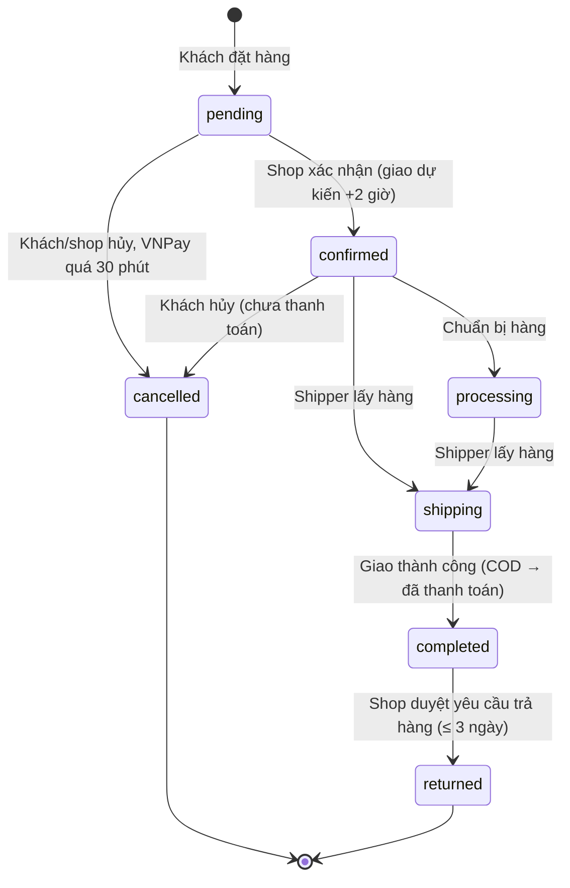

# MiniMart — Website siêu thị mini

Website bán hàng và quản trị cho một siêu thị mini, xây dựng bằng **Laravel 12**. Khách mua hàng trực tuyến, nhân viên quản lý sản phẩm và đơn hàng, đội shipper của cửa hàng giao hàng trong 2 giờ và cập nhật hành trình cho khách.

> Đồ án học phần **Lập trình mã nguồn mở** — Nhóm 5.

## Mục lục

- [Tính năng](#tính-năng)
- [Công nghệ](#công-nghệ)
- [Cài đặt](#cài-đặt)
- [Chạy dự án](#chạy-dự-án)
- [Tài khoản mẫu và phân quyền](#tài-khoản-mẫu-và-phân-quyền)
- [Cấu hình tích hợp](#cấu-hình-tích-hợp)
- [Nghiệp vụ đơn hàng](#nghiệp-vụ-đơn-hàng)
- [Kiểm thử](#kiểm-thử)
- [Cấu trúc thư mục](#cấu-trúc-thư-mục)
- [Quy ước làm việc nhóm](#quy-ước-làm-việc-nhóm)

## Tính năng

### Khách hàng
- Trang chủ có thanh trượt ưu đãi theo danh mục; tìm kiếm, lọc theo danh mục, thương hiệu, khoảng giá, hàng đang giảm giá.
- Đăng ký, đăng nhập (kể cả **bằng Google**), quên và đặt lại mật khẩu.
- Giỏ hàng, áp **mã giảm giá**, thanh toán **COD** hoặc **VNPay**; miễn phí giao cho đơn từ 300.000đ.
- **Theo dõi đơn** theo tab giống Shopee: Chờ xác nhận · Chờ lấy hàng · Chờ giao hàng · Đã giao · Đã hủy · Trả hàng/Hoàn tiền; xem thanh tiến trình, giờ giao dự kiến, gọi shipper, dòng thời gian hành trình.
- Hủy đơn chưa xử lý, mua lại đơn cũ, **yêu cầu trả hàng/hoàn tiền** trong 3 ngày, đánh giá sản phẩm đã mua.
- **Chuông thông báo** khi đơn được xác nhận, đang giao, giao xong, có kết quả trả hàng.
- **Giải cứu thực phẩm** sắp hết hạn với giá giảm và tích **điểm xanh**.
- **Trợ lý nấu ăn AI** (Google Gemini) gợi ý nguyên liệu, cách làm và thêm nhanh sản phẩm vào giỏ; nút trợ lý là **thú cưng rau củ** khách tự chọn trong Hồ sơ.

### Quản trị (`/admin`)
- Dashboard: thống kê, biểu đồ doanh thu 6 tháng, cảnh báo tồn kho thấp.
- **Báo cáo doanh thu** theo tháng/ngày/12 tháng và **báo cáo mặt hàng, tồn kho**.
- Quản lý danh mục, sản phẩm (nhiều ảnh, ảnh chính, xóa mềm, khôi phục), mã giảm giá (tự gõ hoặc tạo ngẫu nhiên), chiến dịch giải cứu, đánh giá, tài khoản và phân quyền.
- Quản lý đơn hàng: cập nhật trạng thái, **phân công shipper**, ghi hành trình, **duyệt trả hàng**.
- **Báo đơn mới** cho nhân viên: chuông, tiếng "ting", thông báo trên máy tính, huy hiệu số đơn chờ xác nhận ở menu.

### Shipper (`/giao-hang`)
- Trang tối ưu cho điện thoại: đơn cần lấy, đang giao, đã giao hôm nay; gọi khách, mở bản đồ, số tiền cần thu COD.
- Xác nhận lấy hàng, gửi vị trí cho khách, xác nhận giao thành công hoặc ghi nhận giao chưa thành công.

### Hệ thống
- Tồn kho theo **lô hàng**: trừ kho trong cùng một giao dịch, khóa dòng chống bán vượt, ghi lịch sử xuất/nhập kho; hủy đơn tự hoàn kho.
- Đơn VNPay bỏ dở **tự hủy sau 30 phút** và hoàn kho.
- Thông báo chỉ gửi sau khi giao dịch cơ sở dữ liệu hoàn tất; mọi thay đổi đơn hàng đi qua `OrderService`.

## Công nghệ

| Thành phần | Công nghệ |
|---|---|
| Backend | PHP 8.2+, Laravel 12, Laravel Socialite |
| Cơ sở dữ liệu | MySQL 8 (SQLite trong bộ nhớ khi chạy test) |
| Giao diện | Blade, Bootstrap 5, Vite 7, JavaScript thuần |
| Thanh toán | VNPay Sandbox |
| Lưu ảnh | Ổ `public` của Laravel hoặc Supabase Storage (giao thức S3) |
| AI | Google Gemini API |
| Địa chỉ | API địa chỉ hành chính Việt Nam (tỉnh/thành, phường/xã) |
| Thông báo, tác vụ định kỳ | Laravel Notifications (database), Task Scheduling |
| Kiểm thử, định dạng code | PHPUnit, Laravel Pint |

## Cài đặt

**Yêu cầu:** PHP 8.2+, Composer, Node.js 20.19+ (Vite 7), MySQL 8 (Laragon đã có sẵn PHP và MySQL).

```powershell
git clone https://github.com/NguyenEvelyn/Mini_mart_php.git
cd Mini_mart_php
composer install
Copy-Item .env.example .env      # macOS/Linux: cp .env.example .env
php artisan key:generate
```

Tạo database `mini_mart` trong MySQL (Laragon: *Menu → MySQL → Create database*), kiểm tra thông tin `DB_*` trong `.env`, rồi chạy:

```powershell
php artisan migrate --seed
php artisan storage:link
npm install
npm run build
```

Hướng dẫn riêng cho Laragon nằm trong [`docs/LARAGON.md`](docs/LARAGON.md).

### Sau mỗi lần `git pull`

```powershell
composer install          # khi composer.lock thay đổi
php artisan migrate       # khi có migration mới
npm install; npm run build   # khi CSS/JS thay đổi
```

Muốn thêm mã giảm giá mẫu mà không đặt lại dữ liệu: `php artisan db:seed --class=CouponSeeder`.

## Chạy dự án

```powershell
php artisan serve           # http://localhost:8000
npm run dev                 # Vite tự cập nhật CSS/JS khi sửa giao diện
php artisan schedule:work   # tự hủy đơn VNPay bỏ dở (chạy nền)
```

Hoặc chạy cùng lúc server, hàng đợi, log và Vite: `composer run dev`.

> Có thể mở web qua địa chỉ Laragon (ví dụ `http://mini-mart-laravel.test`), nhưng **đăng nhập Google chỉ hoạt động qua `http://localhost:8000`** (xem phần Google bên dưới).

## Tài khoản mẫu và phân quyền

Seeder tạo các tài khoản dùng chung mật khẩu `Password@123`:

| Vai trò | Email | Được dùng |
|---|---|---|
| Super Admin | `admin@minimart.test` | Toàn bộ `/admin`, kể cả tài khoản và phân quyền |
| Quản lý | `manager@minimart.test` | `/admin` trừ tài khoản; quản lý danh mục và mã giảm giá |
| Nhân viên | `staff@minimart.test` | `/admin`: sản phẩm, đơn hàng, giải cứu, đánh giá, báo cáo |
| Shipper | `shipper@minimart.test` | `/giao-hang` (số điện thoại mẫu `0909123456`) |
| Khách hàng | `customer@minimart.test` | Cửa hàng và mục Tài khoản |

> Chỉ dùng cho môi trường phát triển. Đổi mật khẩu mẫu trước khi triển khai thật.

Tạo thêm shipper: **Quản trị → Tài khoản & phân quyền → Thêm tài khoản**, chọn vai trò *Shipper* và nhập số điện thoại để khách gọi được.

## Cấu hình tích hợp

Các khóa bí mật chỉ ghi trong `.env`, **không** commit lên GitHub. Thiếu cấu hình thì tính năng tương ứng tự báo "chưa cấu hình", các phần khác vẫn chạy.

### Đăng nhập bằng Google

1. Google Cloud Console → *APIs & Services → Credentials* → tạo **OAuth Client ID** loại *Web application*.
2. Thêm vào **Authorized redirect URIs**: `http://localhost:8000/dang-nhap/google/callback`.
3. Khai báo trong `.env`:

```env
GOOGLE_CLIENT_ID=...
GOOGLE_CLIENT_SECRET=...
GOOGLE_REDIRECT_URI=http://localhost:8000/dang-nhap/google/callback
```

Google chỉ cho phép `http` với `localhost` và **không nhận tên miền `.test`** (lỗi `400: invalid_request`). Nếu bấm "Tiếp tục với Google" từ địa chỉ khác, website tự chuyển sang `GOOGLE_REDIRECT_URI` để hoàn tất. Khi ứng dụng OAuth đang ở chế độ *Testing*, chỉ email trong danh sách *Test users* mới đăng nhập được.

### VNPay Sandbox

Đăng ký merchant thử nghiệm tại <https://sandbox.vnpayment.vn/devreg>, rồi điền:

```env
VNPAY_TMN_CODE=ma_website
VNPAY_HASH_SECRET=chuoi_bi_mat
VNPAY_RETURN_URL=            # để trống khi chạy local
```

URL trả về mặc định là `/thanh-toan/vnpay/return`. IPN (`/thanh-toan/vnpay/ipn`) chỉ gọi được khi website có địa chỉ HTTPS công khai.

### Trợ lý nấu ăn (Gemini)

Tạo khóa tại <https://aistudio.google.com/api-keys> và điền `GEMINI_API_KEY`, `GEMINI_MODEL`.

### Lưu ảnh trên Supabase Storage (tùy chọn)

Mặc định ảnh lưu ở `storage/app/public` (`MEDIA_DISK=public`). Để lưu trên Supabase, điền các biến `SUPABASE_S3_*`, `SUPABASE_PUBLIC_URL` và đặt `MEDIA_DISK=supabase`.

### Email

Mặc định `MAIL_MAILER=log`: email (ví dụ liên kết đặt lại mật khẩu) được ghi vào `storage/logs/laravel.log`. Muốn gửi thật, cấu hình SMTP trong các biến `MAIL_*`.

## Nghiệp vụ đơn hàng



- **Tồn kho:** trừ ngay khi đặt hàng theo từng lô (ưu tiên lô đang giải cứu, rồi lô gần hết hạn); hủy đơn thì hoàn kho. Hàng khách trả về **không** tự nhập lại kho để nhân viên kiểm tra trước.
- **Mã giảm giá:** giảm theo % hoặc số tiền, có đơn tối thiểu, mức giảm tối đa, thời hạn và giới hạn lượt dùng; chỉ giảm trên tiền hàng, không giảm phí giao. Lượt dùng được trả lại khi hủy đơn. Mã mẫu: `WELCOME15` (giảm 15% cho đơn từ 300.000đ).
- **Điểm xanh:** mỗi sản phẩm giải cứu trong đơn đã giao được 10 điểm; đơn bị hủy hoặc trả hàng thì thu hồi.
- **Thông báo:** khách nhận thông báo theo từng mốc hành trình; nhân viên nhận thông báo đơn mới (COD ngay khi đặt, VNPay khi đã thanh toán), khách hủy đơn, yêu cầu trả hàng, giao chưa thành công. Trình duyệt hỏi server mỗi 15 giây (nhân viên) hoặc 30 giây (khách).
- **Đơn VNPay bỏ dở:** lệnh `orders:expire-unpaid` chạy 5 phút một lần, hủy đơn chưa thanh toán sau 30 phút và hoàn kho. Trên server cần cron `* * * * * php /duong-dan/artisan schedule:run`; chạy tay: `php artisan orders:expire-unpaid --minutes=30`.

## Kiểm thử

```powershell
composer test        # hoặc: php artisan test
vendor/bin/pint      # định dạng code theo chuẩn Laravel
```

61 ca kiểm thử chạy trên SQLite trong bộ nhớ (không đụng database thật), gồm:

| File | Nội dung |
|---|---|
| `StorefrontTest` | Cửa hàng, giỏ hàng, checkout, VNPay, tồn kho theo lô, giải cứu, phân quyền |
| `CouponTest` | Áp mã, giới hạn lượt dùng, tạo mã tự động |
| `CustomerCancelOrderTest` | Khách hủy đơn và hoàn kho |
| `OrderTrackingTest` | Phân công shipper, hành trình, tab đơn hàng, trả hàng |
| `NotificationTest` | Thông báo cho khách và nhân viên |
| `GoogleAuthTest` | Đăng nhập Google, chuyển đúng địa chỉ callback |
| `AssistantPetTest` | Chọn thú cưng cho trợ lý AI |

## Cấu trúc thư mục

```text
app/
  Http/Controllers/        Controller cửa hàng, tài khoản, shipper, thông báo
  Http/Controllers/Admin/  Controller khu quản trị (đơn hàng, báo cáo, mã giảm giá...)
  Models/                  Eloquent model (Order, Product, InventoryLot, ReturnRequest...)
  Services/                OrderService (vòng đời đơn hàng), VnpayService, CookingAssistantService
  Support/                 Notifier (gửi thông báo), AssistantPet (thú cưng trợ lý)
  Notifications/           StoreNotification (thông báo lưu trong database)
database/
  migrations/, seeders/    Cấu trúc bảng và dữ liệu mẫu
resources/
  views/store, account     Giao diện cửa hàng và tài khoản khách
  views/admin              Giao diện quản trị
  views/shipper            Giao diện shipper
  views/components         Component dùng chung (chuông thông báo, dòng thời gian, thú cưng...)
  css/app.css, js/app.js   Giao diện và tương tác phía trình duyệt
routes/web.php             Khai báo route; routes/console.php: lệnh và lịch chạy
tests/Feature/             Kiểm thử tự động
docs/                      Tài liệu: Laragon, ERD, sơ đồ lớp (draw.io), quy trình đặt hàng
```

## Quy ước làm việc nhóm

- Làm trên nhánh riêng (ví dụ `feature/...`), mở Pull Request vào `main`; không force push lên `main`.
- Commit nhỏ theo từng phần, tiêu đề dạng `feat: ...` / `fix: ...` / `refactor: ...` / `style: ...`, nội dung tiếng Việt.
- Trước khi push: chạy `php artisan test` và `vendor/bin/pint`.
- Không commit `.env`, `vendor/`, `node_modules/`, `public/build/`, database hoặc log; khóa bí mật chỉ để trong `.env`.
- Đặt `APP_DEBUG=false` và dùng HTTPS khi triển khai thật.

## Giấy phép

Phát hành theo giấy phép MIT.
