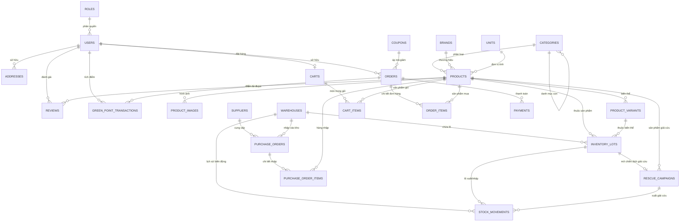

# Sơ đồ Cơ sở Dữ liệu (ERD) - Mini Mart

Tài liệu này tổng hợp toàn bộ cấu trúc cơ sở dữ liệu của dự án Mini Mart bao gồm 22 bảng nghiệp vụ chính, khóa chính (PK), khóa ngoại (FK) và mối quan hệ.

---

## 1. Mã DBML (Dùng cho https://dbdiagram.io)
> **Hướng dẫn**: Truy cập [dbdiagram.io](https://dbdiagram.io), dán toàn bộ đoạn mã bên dưới vào khung soạn thảo để tự động sinh sơ đồ ERD trực quan, đẹp mắt và xuất file PDF/PNG.

```dbml
// ==========================================
// 1. NGƯỜI DÙNG & PHÂN QUYỀN
// ==========================================
Table roles {
  id bigint [pk, increment]
  name varchar
  slug varchar [unique]
  description text
  created_at timestamp
  updated_at timestamp
}

Table users {
  id bigint [pk, increment]
  role_id bigint [ref: > roles.id]
  name varchar
  email varchar [unique]
  google_id varchar [unique]
  phone varchar(20) [unique]
  avatar varchar
  is_active boolean [default: true]
  last_login_at timestamp
  email_verified_at timestamp
  password varchar
  remember_token varchar
  created_at timestamp
  updated_at timestamp
}

Table addresses {
  id bigint [pk, increment]
  user_id bigint [ref: > users.id]
  recipient_name varchar
  phone varchar(20)
  province varchar
  district varchar
  ward varchar
  address_line varchar
  is_default boolean [default: false]
  created_at timestamp
  updated_at timestamp
}

// ==========================================
// 2. SẢN PHẨM & DANH MỤC
// ==========================================
Table categories {
  id bigint [pk, increment]
  parent_id bigint [ref: > categories.id]
  name varchar
  slug varchar [unique]
  description text
  image varchar
  sort_order int [default: 0]
  is_active boolean [default: true]
  created_at timestamp
  updated_at timestamp
  deleted_at timestamp
}

Table brands {
  id bigint [pk, increment]
  name varchar
  slug varchar [unique]
  logo varchar
  description text
  is_active boolean [default: true]
  created_at timestamp
  updated_at timestamp
  deleted_at timestamp
}

Table units {
  id bigint [pk, increment]
  name varchar
  symbol varchar(20) [unique]
  created_at timestamp
  updated_at timestamp
}

Table products {
  id bigint [pk, increment]
  category_id bigint [ref: > categories.id]
  brand_id bigint [ref: > brands.id]
  unit_id bigint [ref: > units.id]
  name varchar
  slug varchar [unique]
  sku varchar [unique]
  barcode varchar [unique]
  short_description text
  description text
  cost_price decimal(15,2)
  selling_price decimal(15,2)
  sale_price decimal(15,2)
  sale_starts_at timestamp
  sale_ends_at timestamp
  track_lot boolean [default: false]
  track_expiry boolean [default: false]
  is_featured boolean [default: false]
  is_active boolean [default: true]
  created_at timestamp
  updated_at timestamp
  deleted_at timestamp
}

Table product_images {
  id bigint [pk, increment]
  product_id bigint [ref: > products.id]
  path varchar
  alt_text varchar
  sort_order int [default: 0]
  is_primary boolean [default: false]
  created_at timestamp
  updated_at timestamp
}

Table product_variants {
  id bigint [pk, increment]
  product_id bigint [ref: > products.id]
  name varchar
  options json
  sku varchar [unique]
  barcode varchar [unique]
  cost_price decimal(15,2)
  selling_price decimal(15,2)
  sale_price decimal(15,2)
  is_active boolean [default: true]
  created_at timestamp
  updated_at timestamp
  deleted_at timestamp
}

// ==========================================
// 3. KHO BÃI & NHẬP XUẤT TỒN
// ==========================================
Table warehouses {
  id bigint [pk, increment]
  name varchar
  code varchar [unique]
  address varchar
  is_active boolean [default: true]
  created_at timestamp
  updated_at timestamp
}

Table inventory_lots {
  id bigint [pk, increment]
  warehouse_id bigint [ref: > warehouses.id]
  product_id bigint [ref: > products.id]
  product_variant_id bigint [ref: > product_variants.id]
  lot_number varchar
  manufactured_at date
  expires_at date
  quantity decimal(15,3)
  reserved_quantity decimal(15,3)
  unit_cost decimal(15,2)
  created_at timestamp
  updated_at timestamp
}

Table suppliers {
  id bigint [pk, increment]
  name varchar
  code varchar [unique]
  contact_name varchar
  phone varchar(20)
  email varchar
  tax_code varchar
  address varchar
  is_active boolean [default: true]
  created_at timestamp
  updated_at timestamp
  deleted_at timestamp
}

Table purchase_orders {
  id bigint [pk, increment]
  code varchar [unique]
  supplier_id bigint [ref: > suppliers.id]
  warehouse_id bigint [ref: > warehouses.id]
  created_by bigint [ref: > users.id]
  status varchar
  ordered_at date
  expected_at date
  total_amount decimal(15,2)
  note text
  created_at timestamp
  updated_at timestamp
}

Table purchase_order_items {
  id bigint [pk, increment]
  purchase_order_id bigint [ref: > purchase_orders.id]
  product_id bigint [ref: > products.id]
  product_variant_id bigint [ref: > product_variants.id]
  quantity decimal(15,3)
  received_quantity decimal(15,3)
  unit_cost decimal(15,2)
  line_total decimal(15,2)
  created_at timestamp
  updated_at timestamp
}

Table stock_movements {
  id bigint [pk, increment]
  warehouse_id bigint [ref: > warehouses.id]
  product_id bigint [ref: > products.id]
  product_variant_id bigint [ref: > product_variants.id]
  inventory_lot_id bigint [ref: > inventory_lots.id]
  rescue_campaign_id bigint [ref: > rescue_campaigns.id]
  created_by bigint [ref: > users.id]
  type varchar
  quantity decimal(15,3)
  reference_type varchar
  reference_id bigint
  note text
  created_at timestamp
  updated_at timestamp
}

// ==========================================
// 4. GIỎ HÀNG, KHUYẾN MÃI & ĐƠN HÀNG
// ==========================================
Table coupons {
  id bigint [pk, increment]
  code varchar [unique]
  type varchar
  value decimal(15,2)
  minimum_order_amount decimal(15,2)
  maximum_discount_amount decimal(15,2)
  usage_limit int
  used_count int [default: 0]
  starts_at timestamp
  expires_at timestamp
  is_active boolean [default: true]
  created_at timestamp
  updated_at timestamp
}

Table carts {
  id bigint [pk, increment]
  user_id bigint [ref: > users.id]
  session_id uuid [unique]
  created_at timestamp
  updated_at timestamp
}

Table cart_items {
  id bigint [pk, increment]
  cart_id bigint [ref: > carts.id]
  product_id bigint [ref: > products.id]
  product_variant_id bigint [ref: > product_variants.id]
  quantity decimal(15,3)
  created_at timestamp
  updated_at timestamp
}

Table orders {
  id bigint [pk, increment]
  code varchar [unique]
  user_id bigint [ref: > users.id]
  coupon_id bigint [ref: > coupons.id]
  customer_name varchar
  customer_phone varchar(20)
  customer_email varchar
  shipping_address text
  status varchar
  payment_status varchar
  subtotal decimal(15,2)
  discount_amount decimal(15,2)
  shipping_fee decimal(15,2)
  total_amount decimal(15,2)
  customer_note text
  cancel_reason text
  cancelled_at timestamp
  created_at timestamp
  updated_at timestamp
}

Table order_items {
  id bigint [pk, increment]
  order_id bigint [ref: > orders.id]
  product_id bigint [ref: > products.id]
  product_variant_id bigint [ref: > product_variants.id]
  product_name varchar
  sku varchar
  quantity decimal(15,3)
  unit_price decimal(15,2)
  line_total decimal(15,2)
  created_at timestamp
  updated_at timestamp
}

Table payments {
  id bigint [pk, increment]
  order_id bigint [ref: > orders.id]
  method varchar
  transaction_id varchar [unique]
  amount decimal(15,2)
  status varchar
  paid_at timestamp
  metadata json
  created_at timestamp
  updated_at timestamp
}

Table reviews {
  id bigint [pk, increment]
  user_id bigint [ref: > users.id]
  product_id bigint [ref: > products.id]
  order_item_id bigint [ref: > order_items.id]
  rating tinyint
  title varchar
  content text
  status varchar
  created_at timestamp
  updated_at timestamp
}

// ==========================================
// 5. GIẢI CỨU NÔNG SẢN & ĐIỂM XANH
// ==========================================
Table rescue_campaigns {
  id bigint [pk, increment]
  inventory_lot_id bigint [unique, ref: > inventory_lots.id]
  product_id bigint [ref: > products.id]
  discount_percent tinyint
  original_price decimal(15,2)
  rescue_price decimal(15,2)
  initial_quantity decimal(15,3)
  rescued_quantity decimal(15,3) [default: 0]
  is_active boolean [default: true]
  starts_at timestamp
  ends_at timestamp
  created_at timestamp
  updated_at timestamp
}

Table green_point_transactions {
  id bigint [pk, increment]
  user_id bigint [ref: > users.id]
  order_id bigint [ref: > orders.id]
  points int
  reason varchar
  created_at timestamp
  updated_at timestamp
}
```

---

## 2. Sơ đồ Mermaid (Hiển thị ngay trên Markdown / VS Code)


