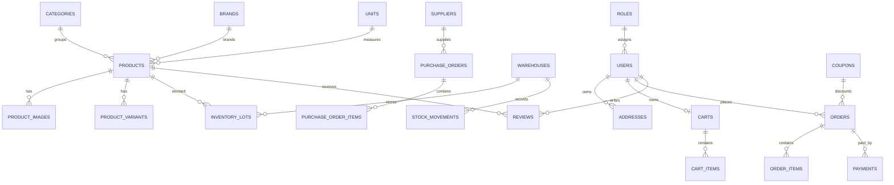

# ERD Mini Mart

`product_variants.options` lưu thuộc tính linh hoạt dạng JSON, ví dụ
`{"Màu sắc":"Đỏ","Kích thước":"L"}`. Tồn kho được quản lý theo kho, biến thể,
lô sản xuất và hạn sử dụng; mọi thay đổi số lượng được ghi trong `stock_movements`.
